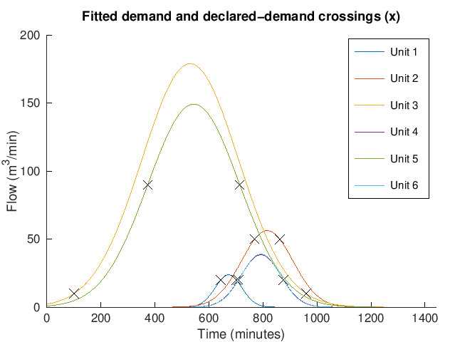
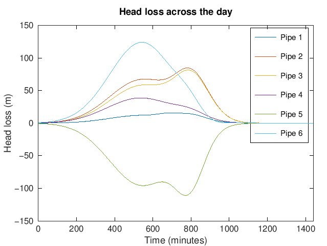
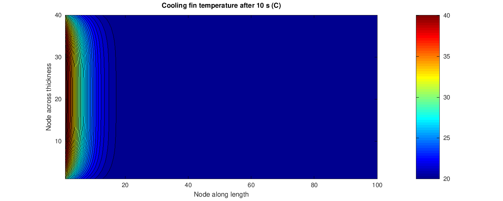
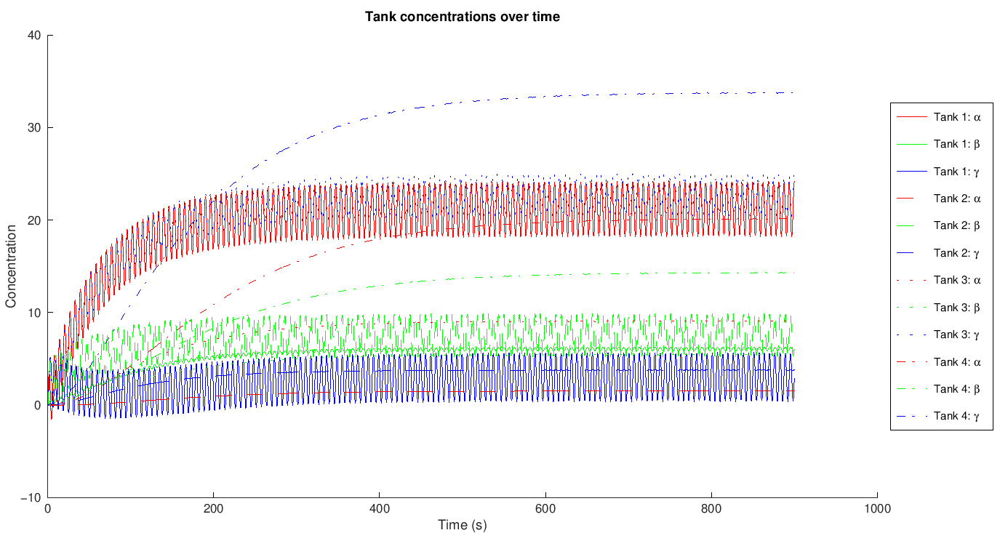

# Numerical methods in MATLAB

Four engineering problems I solved in the second year of my Mechanical Engineering degree at the University of Sussex (2024). Each one needed a different numerical method: linear systems, root-finding, finite differences and ODE integration. The aim was to model a physical system, solve it, and check whether the answer made sense.

| # | Problem | Method | Folder |
|---|---|---|---|
| 1 | Flows and pressure losses in a water supply network | Linearised loop equations + Gaussian elimination with partial pivoting | [`01_water_network`](01_water_network) |
| 2 | Supply pressure as demand varies over a day | Curve fitting of noisy data, bracketing + Ridder's method, repeated network solves | [`02_demand_variation`](02_demand_variation) |
| 3 | Temperature field in a cooling fin | 2D transient explicit finite differences with ghost-node boundaries | [`03_cooling_fin`](03_cooling_fin) |
| 4 | Three chemicals mixing across four tanks | 12 coupled ODEs integrated with `ode45` | [`04_mixing_tanks`](04_mixing_tanks) |

Shared solver: [`lib/gaussPiv.m`](lib/gaussPiv.m).

---

## 1. Water supply network

A site main feeds six industrial units through nine pipes. Writing continuity at each node (6 equations) and a head balance round each loop (3 equations) gives a 9×9 system. Head loss depends on Q², so I linearised it about the previous estimate and re-solved until the flows stopped changing. I wrote my own Gaussian elimination with partial pivoting rather than using `\`.

| Pipe | Q1 | Q2 | Q3 | Q4 | Q5 | Q6 | Q7 | Q8 | Q9 |
|---|---|---|---|---|---|---|---|---|---|
| Flow (L/s) | 111.3 | 38.8 | 37.2 | 178.8 | 52.4 | 36.0 | 51.6 | 22.4 | 21.6 |

Check: the two supply pipes (Q1 + Q4 = 290 L/s) carry exactly the total demand of the six units.

## 2. Demand variation over a day

Each unit's flow was logged every minute for 24 hours. I fitted a Gaussian to each noisy series, then used Ridder's method to find when each unit goes over its declared demand, and re-solved the network for all 1,440 minutes.



| Unit | Over declared demand |
|---|---|
| 1 | 10:44 – 11:41 |
| 2 | 12:49 – 14:22 |
| 3 | 01:41 – 16:00 |
| 4 | 11:48 – 14:36 |
| 5 | 06:13 – 11:54 |
| 6 | Never exceeds it |



Negative head loss in a pipe means its flow runs opposite to the direction I assumed when setting up the network.

## 3. Cooling fin

A 4 cm × 1 cm fin with heat flux into its base, convection from its top face and a symmetry line along the bottom. I discretised it on a 100 × 20 grid, using forward Euler in time and central differences in space, and imposed each boundary condition through a ring of ghost nodes.



## 4. Mixing tanks

A mass balance on each chemical in each tank gives 12 coupled ODEs with oscillating injection terms. I integrated them with `ode45` and extended the time span until every concentration had settled into a steady periodic pattern.



---

## What I would do differently

- **Cooling fin time step.** The explicit scheme is stable up to dt ≈ 0.087 s, but I used 0.001 s, so 10,000 steps only cover 10 seconds. The fin's thermal time constant (L²/α) is around 48 minutes, so the plot shows the very start of the transient, not steady state. A time step near the stability limit, or an implicit (Crank–Nicolson) scheme, would reach steady state in far fewer steps.
- **Curve fitting.** The Gaussian coefficients were fitted with MATLAB's Curve Fitting Toolbox and pasted in. Doing the fit in the script with `lsqcurvefit` would make it reproducible from the raw data.
- **Vectorisation.** The fin update uses nested loops; the same update written with array indexing runs much faster.

## Running it

Each folder is self-contained. Run from that folder in MATLAB:

```matlab
water_network          % problem 1, prints flows and pressure losses
demand_variation       % problem 2
cooling_fin            % problem 3
mixing_tanks           % problem 4
```

## References

- Ridder, C. (1979). A new algorithm for computing a single root of a real continuous function. *IEEE Transactions on Circuits and Systems*, 26(11).
- Kiusalaas, J. (2016). *Numerical Methods in Engineering with MATLAB*, 3rd ed. Cambridge University Press. My Ridder's method implementation follows the structure given here.

